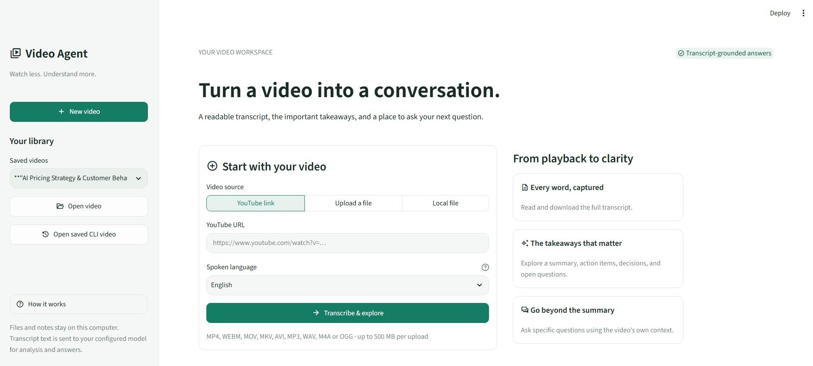
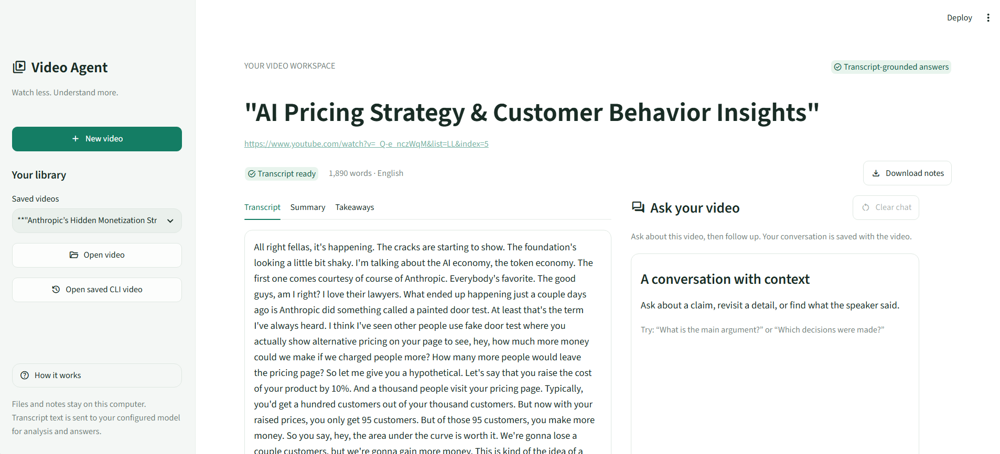

# MediaTalk AI

Turn video and audio recordings into searchable transcripts, structured notes, and contextual conversations.

MediaTalk AI is a Python and Streamlit application that combines speech recognition, Mistral-powered analysis, and retrieval-augmented generation (RAG). Users can read a transcript or summary, then ask questions about the recording in the same workspace.

**Status:** Local application. Public deployment is planned; no verified public demo is available yet.

## The problem

Reviewing recordings often requires repeated listening and manually collecting important information. MediaTalk AI brings transcription, summarization, and follow-up questions into one workflow.

The intended use cases include reviewing educational videos, recorded discussions, and meetings. User adoption and real-world time savings have not yet been measured.

## Features

- Process YouTube links, uploaded media, or local media paths.
- Transcribe English audio locally with faster-whisper.
- Process Hinglish audio through Sarvam's speech-to-text translation API.
- Generate a title, summary, action items, key decisions, and open questions.
- Ask questions using relevant passages retrieved from the transcript.
- Use recent conversation history for follow-up questions.
- Reopen saved videos and their conversations.
- Download transcripts as TXT and notes as Markdown.
- Reuse cached transcriptions to avoid repeating speech recognition.
- Preserve the transcript and searchable index when remote analysis fails.

## Screenshots

### Home
Choose a YouTube link, upload media, or provide a local file.



### Transcript
Read the processed recording and download its transcript.



### Summary and conversation
Review the summary and ask questions about the recording.


## How it works

```text
YouTube link / uploaded media / local file
                    |
          Audio conversion and chunking
                    |
       English: local faster-whisper
       Hinglish: Sarvam API
                    |
                Transcript
                    |
       Local embeddings and Chroma index
                    |
        Mistral summary and takeaways
                    |
          Read results and ask questions
                    |
    Retrieve transcript passages + recent chat
                    |
             Mistral-generated answer
```

New videos processed through the Streamlit interface use separate Chroma collections. This keeps retrieval scoped to the selected video.

## Product decisions

| User need | Implementation | Tradeoff |
| --- | --- | --- |
| Avoid repeating slow processing | Content-based transcription cache | Cached transcripts occupy local storage |
| Keep useful progress after API failures | Save the transcript index before remote analysis | Generated analysis still requires working API access |
| Read and ask questions together | Transcript, Summary, and Takeaways alongside chat | Answer quality depends on transcription and retrieval |
| Continue a previous session | Saved video library and per-video chat history | Local persistence requires privacy and storage management |
| Understand waiting time | Processing stages and transcription progress | Initial model downloads can still take time |

These decisions demonstrate product-oriented engineering. They are not evidence of completed user research or product-market fit.

## Technology

- **Interface:** Streamlit
- **Transcription:** faster-whisper; optional original Whisper backend
- **Hinglish processing:** Sarvam API
- **Language model:** Mistral through LangChain
- **Retrieval:** Chroma and local sentence-transformer embeddings
- **Embedding model:** all-MiniLM-L6-v2
- **Media processing:** yt-dlp, pydub, and FFmpeg
- **Testing:** Python unittest and Streamlit AppTest

## Project structure

```text
MediaTalk AI/
├── .streamlit/                # Streamlit configuration
├── core/                      # Transcription, analysis, retrieval, and UI workflow
├── utils/                     # Media processing
├── tests/                     # Automated tests
├── tools/                     # Transcription benchmark utility
├── .env.example               # Configuration template without credentials
├── .gitignore
├── main.py                    # CLI entry point
├── streamlit_app.py            # Streamlit entry point
├── requirements.txt
├── RATE_LIMITS.md
├── STREAMLIT_UI.md
├── TRANSCRIPTION_PERFORMANCE.md
└── README.md
```

Generated databases, transcripts, conversations, media, and credentials are excluded from version control.

## Local setup

The existing development environment runs on Windows with Python 3.14.3. A fresh installation of the cleaned dependency file still needs verification.

### Prerequisites

- Python and a virtual environment
- FFmpeg installed and available on PATH
- A Mistral API key with access to the configured model
- A Sarvam API key only when using Hinglish processing
- Internet access for model downloads and remote API requests

From the project directory, create a virtual environment and install dependencies:

```powershell
python -m venv .venv
.\.venv\Scripts\python.exe -m pip install -r requirements.txt
```

For a new installation, copy `.env.example` to `.env` and fill in your credentials. Keep an existing configured `.env` file.

The default configuration uses:

```dotenv
MISTRAL_MODEL=ministral-3b-latest
WHISPER_ENGINE=faster
WHISPER_MODEL=small
TRANSCRIPTION_CACHE=1
```

Model availability depends on your Mistral account. Never commit `.env` or API keys.

### Start the Streamlit application

```powershell
.\.venv\Scripts\python.exe -m streamlit run streamlit_app.py
```

Open the local URL printed in the terminal.

1. Choose a YouTube link, uploaded file, or local file path.
2. Select English or Hinglish.
3. Click **Transcribe & explore**.
4. Read the Transcript, Summary, and Takeaways.
5. Ask questions in **Ask your video**.
6. Reopen saved work from **Your library**.

The first run may take longer while transcription and embedding models download.

### CLI alternative

Process a recording:

```powershell
.\.venv\Scripts\python.exe main.py
```

Reopen the saved CLI transcript index:

```powershell
.\.venv\Scripts\python.exe main.py --chat
```

The legacy CLI uses a shared collection that may contain material from multiple runs. The Streamlit workflow creates a separate collection for each new video.

## Validation and performance

Run the automated tests:

```powershell
.\.venv\Scripts\python.exe -m unittest discover -s tests -v
```

Tests cover areas including API error handling, transcription caching, vector-store persistence, chat context, and Streamlit workflow recovery. Many tests use simulated API responses; they do not establish live service availability.

On one 60-second English audio sample, the speech-recognition stage took:

| Backend | Transcription time |
| --- | ---: |
| Original Whisper | 69.193 seconds |
| Optimized faster-whisper | 13.324 seconds |

This was approximately **5.19× faster for that sample**. It excludes media downloading, conversion, model loading, indexing, and remote analysis. It is not an end-to-end performance guarantee or a formal accuracy evaluation.

See [Transcription performance](TRANSCRIPTION_PERFORMANCE.md) for methodology and reproduction commands.

## Limitations and privacy

- Generated summaries and answers may contain mistakes; check them against the transcript.
- Questions are answered from the recording, not through independent web fact-checking.
- Mistral model access, account quotas, and rate limits can prevent analysis or answers.
- English speech recognition and embeddings run locally, but transcript content and chat context are sent to Mistral.
- Hinglish processing sends audio to Sarvam.
- Transcripts, embeddings, notes, and conversations persist on the machine running the application.
- Separate video collections are not user authentication or access control.
- The current application is intended for local use. Public deployment needs additional work on user isolation, storage, and resource limits.

## Planned improvements

- Prepare and verify a Streamlit Community Cloud demonstration.
- Evaluate transcription and answer quality on a broader set of recordings.
- Improve source references so users can verify answers more easily.
- Add appropriate access controls and retention options for hosted use.

## Additional documentation

- [Streamlit workflow and storage](STREAMLIT_UI.md)
- [API rate-limit handling](RATE_LIMITS.md)
- [Transcription benchmark](TRANSCRIPTION_PERFORMANCE.md)

## Author

**Dev Harshul Savaliya**

Career focus: AI Product Management.

- [GitHub](https://github.com/DevSavaliya)
- [LinkedIn](https://www.linkedin.com/in/dev-savaliya/)

## License

This project is licensed under the [MIT License](LICENSE).